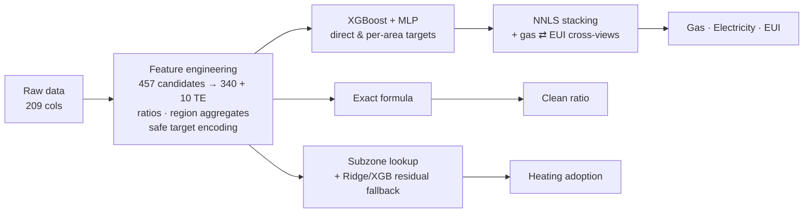

# Urban Energy Transition Modeling

**Predicting five building-energy indicators for 184K buildings, where one target turned out to need no model at all.**

My solution for the [DICE FEST 2026 Machine Learning Competition](https://www.kaggle.com/competitions/dicefest-2026-machine-learning) on Kaggle: a multi-output pipeline built on XGBoost + MLP stacking, exact-formula recovery, and leakage-safe target encoding.

| Out-of-fold NRMSE | Spatial audit (GroupKFold) | Kaggle score |
|:---:|:---:|:---:|
| **0.2550** | 0.2814 (simpler baseline) | ~0.252 |

---

## The Challenge

The competition frames the **Urban Energy Transition Trilemma**: cut gas use, avoid overloading the power grid, and get building owners to actually renovate. The task is to predict five indicators from anonymized building, climate, and sociodemographic features (**429,303** training rows, **183,987** test rows, 209 columns):

| # | Target | What it tells us |
|---|---|---|
| 1 | Total gas consumption (kWh) | Where system-scale gas demand sits |
| 2 | Total electricity consumption (kWh) | Where grid load is concentrated |
| 3 | Gas intensity, EUI (kWh/m²) | Which buildings are inefficient per square meter |
| 4 | Clean building ratio (%) | How "green" the stock is |
| 5 | Electric heating adoption (%) | How far electrification has progressed |

Each target counts for 20% of the score (mean of five normalized RMSEs, lower is better).

## Key Findings

**1. One target needed zero machine learning.**
During EDA I tested whether any columns were exact functions of each other. Two were:

```
clean_ratio = clip(round(100 × bld_dim_02 / bld_dim_01, 2), 0, 100)   # exact on 100% of training rows
gas_kwh     = gas_EUI × bld_dim_06                                    # exact up to ~1e-10
```

The first gives a **perfect score (NRMSE = 0.000)** on one of five targets, with no model needed. The second works as a consistency link between the gas and EUI predictions: each target's model gets the other's predictions as extra stacking candidates.

**2. Total energy is easy. Efficiency is hard.**
Building size alone correlates ~0.90 with total gas and ~0.88 with electricity. But gas *intensity* (EUI) barely correlates with any single feature (|r| < 0.2), and it stays the hardest target at **0.657 NRMSE**.

**3. Random CV flatters you.**
Observations cluster into 330 regions, and 8% of test rows sit in subzones never seen in training. A random 5-fold split gave 0.255, but holding out entire regions with a simpler baseline gave **0.281**. I kept that number in the report because cross-region generalization is what matters in practice.

## Approach



- **Feature engineering:** area-normalized ratios (`feature / bld_dim_06`), pairwise ratios and log-ratios, region and subzone aggregates built from features only (no labels), relative-size and rank features, and target encoding. Encodings for training rows use **inner out-of-fold** splits, and validation/test rows only see labels from the training portion of each fold, so validation labels never leak.
- **Modeling:** XGBoost and an MLP (PyTorch) for gas, electricity, and EUI. For gas and electricity I trained both on the raw target and on a *per-area* target (`y / area`, area-weighted loss), then multiplied back.
- **Stacking:** non-negative least squares (NNLS) over all candidates, with weights fitted fold-by-fold for honest OOF scores. Because `gas = EUI × area`, EUI predictions (rescaled by area) also enter the gas stack, and gas predictions enter the EUI stack.
- **Clean ratio:** the verified formula, applied only after a check that it matches every training row and is defined on every test row.
- **Heating adoption:** subzones seen in training use their smoothed target mean. Unseen subzones (8% of test rows) fall back to a Ridge model on HVAC, sociodemographic, and climate features, with an XGBoost model correcting its residuals.

### Which model won each target

| Target | Selected candidate | OOF NRMSE |
|---|---|:---:|
| Gas (total) | NNLS stack + gas⇄EUI cross-view blend | **0.2488** |
| Electricity (total) | NNLS stack | **0.3184** |
| Gas EUI | NNLS stack + EUI⇄gas cross-view blend | **0.6572** |
| Clean building ratio | Exact formula | **0.0000** |
| Electric heating adoption | Subzone lookup + Ridge/XGB residual fallback | **0.0507** |

## What I Learned About the Models

The XGBoost + MLP combination was found by **trial and error**, not planned up front. The stacking weights show why it works:

- **The MLP carried the most weight.** In the final NNLS stacks, the per-area MLP got **39% of the gas stack and 52% of the electricity stack**, more than any XGBoost candidate. It was also the best single model for both targets (0.2528 gas, 0.3204 electricity vs. 0.2530 and 0.3220 for the best XGBoost).
- **The MLP is far cheaper.** In my runs, 5-fold training for gas took ~100 seconds for the MLP vs. ~750–900 seconds per XGBoost candidate.
- **They complement each other.** Trees handle missing values and sharp regional effects, while the MLP gives smoother functions. Stacking beat every individual model on all three energy targets.
- **EUI is where models struggle most.** XGBoost (0.6675) and MLP (0.6680) were nearly tied alone, and the gain came from stacking and the cross-target views.
- **CatBoost and LightGBM didn't earn a place.** I tested both during development: neither improved the ensemble noticeably, and LightGBM took much longer to train. I dropped them to keep the final pipeline lean, so they don't appear in the final notebook.

## Results

| Target | XGB (direct) | XGB (per-area) | MLP (best) | **Final** |
|---|:---:|:---:|:---:|:---:|
| Gas (total) | 0.2546 | 0.2530 | 0.2528 | **0.2488** |
| Electricity (total) | 0.3238 | 0.3220 | 0.3204 | **0.3184** |
| Gas EUI | 0.6675 | n/a | 0.6680 | **0.6572** |
| Clean building ratio | n/a | n/a | n/a | **0.0000** |
| Electric heating adoption | n/a | n/a | n/a | **0.0507** |
| **Mean (5 targets)** | | | | **0.2550** |

*Spatial audit (region-held-out GroupKFold, plain XGBoost without target encoding, not directly comparable to the ensemble): gas 0.269, electricity 0.329, EUI 0.691, clean 0.000, heating 0.119, mean **0.2814**. Heating suffers most (0.051 → 0.119) when subzone lookups aren't available.*

## Policy Takeaways

The model is meant for **screening and prioritizing**, not for causal claims.

- **Run two priority lists.** Large total gas consumers matter for system planning, while high-EUI buildings are candidates for envelope and insulation audits. They are different buildings.
- **Plan the grid alongside electrification.** Rising electric heating shifts load from gas to electricity, so utilities should combine all three predictions to flag areas for peak-load studies.
- **Target incentives by area.** Adoption gaps call for differentiated programs (e.g., for renters vs. owners) rather than one uniform subsidy.

## Limitations

- Features are anonymized, so physical interpretations (e.g., what `bld_dim_06` really is) can't be verified.
- Feature importance and target-encoding strength show correlation, not causation. The importance plots come from the XGBoost components only, not the full stack.
- The final candidate for each target was picked by its OOF score, so 0.2550 is a model-selection estimate and not a nested-CV result.
- The spatial audit uses a simpler baseline than the final ensemble, and its region aggregates use unlabeled train + test features.
- Predictions are annual totals, so they can't be used for hourly load or transformer-capacity decisions.

## Reproduce

```bash
git clone https://github.com/Linambaran/urban-energy-transition-ml.git
cd urban-energy-transition-ml
pip install -r requirements.txt

# get the data (not included in this repo) and put train.csv + test.csv
# in the same folder as the notebook
kaggle competitions download -c dicefest-2026-machine-learning -p notebooks/
unzip notebooks/dicefest-2026-machine-learning.zip -d notebooks/

cd notebooks && jupyter notebook DICEFEST_2026_EDA_Model_Final.ipynb
```

The notebook looks for `train.csv` and `test.csv` in the working directory, then in `/kaggle/input` and `/mnt/data`, so it also runs as-is on Kaggle. A GPU is optional but speeds up XGBoost and the MLP considerably (in my run, single XGBoost candidates took ~5–15 minutes for 5 folds). Running the notebook writes `submission_dicefest_gabungan.csv` and `feature_importance.png`.

> The dataset belongs to the competition organizers and is not redistributed here. Download it from the [competition page](https://www.kaggle.com/competitions/dicefest-2026-machine-learning).

## Repository Structure

```
├── README.md
├── requirements.txt
├── notebooks/
│   └── DICEFEST_2026_EDA_Model_Final.ipynb
└── report/
    └── DICEFEST_2026_Technical_Writeup.pdf   # full write-up (Bahasa Indonesia)
```

`train.csv`, `test.csv`, and generated submissions are git-ignored.

## Tech Stack

Python · pandas · NumPy · scikit-learn (Ridge, KFold/GroupKFold) · XGBoost · PyTorch (MLP) · SciPy (NNLS) · Matplotlib / Seaborn

## Credits

Notebook, modeling, and experiments: **Linambaran Faradha Qisthas**.
The technical report was co-authored with Ahnaf Sega Fausta and Jocelyn Louisa.

---

The full technical report (in Bahasa Indonesia) covers EDA, validation design, interpretability, and policy recommendations in more depth.
